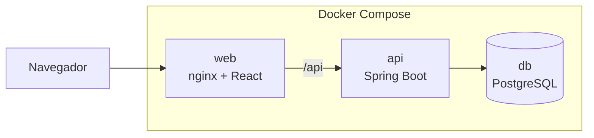
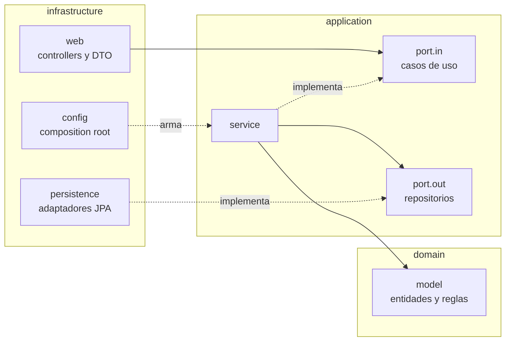

# Financial Management System

Aplicación interna para que los trabajadores de una entidad financiera administren clientes, sus productos (cuentas de ahorros y corrientes) y los movimientos sobre esas cuentas: consignaciones, retiros y transferencias, con su estado de cuenta.

- **Backend:** Java 21, Spring Boot 4, arquitectura hexagonal en módulos Maven, Spring Data JPA y Flyway.
- **Base de datos:** PostgreSQL 17.
- **Frontend:** React 19, TypeScript, Vite, MUI, TanStack Query, React Hook Form y Zod.
- **Infraestructura:** Docker Compose, GitHub Actions, GitHub Container Registry y AWS (CloudFront + EC2).

**Demo:** https://dj7xf44ldmk05.cloudfront.net (disponible durante el periodo de evaluación).

## Funcionalidades y reglas de negocio

Cada regla se valida en el dominio o en el servicio y, además, en la base de datos como defensa en profundidad: aunque alguien escriba directo en la BD, los datos no quedan inconsistentes.

### Clientes

Registro, consulta, actualización y eliminación.

| Regla | Aplicación | Base de datos |
|---|---|---|
| No puede existir un cliente menor de edad | `Client.create` / `update` (`CLIENT_UNDERAGE`) | `ck_clients_legal_age` |
| Correo con formato `xxxx@xxxxx.xxx` | `Client` | `ck_clients_email_format` |
| Nombre y apellido de al menos 2 caracteres | `Client` | `ck_clients_first_name_length`, `ck_clients_last_name_length` |
| Fechas de creación y modificación automáticas | `Client` con un `Clock` inyectado | `ck_clients_updated_after_created` |
| Tipo y número de identificación únicos | `ClientService` (`CLIENT_ALREADY_EXISTS`) | `uq_clients_identification` |
| No se elimina un cliente con productos | `ClientService` (`CLIENT_HAS_PRODUCTS`) | `fk_accounts_client` (`ON DELETE RESTRICT`) |

### Cuentas

Apertura, consulta (todas o por cliente), activación, inactivación y cancelación. Las cuentas no se borran: se cancelan y conservan su historial.

| Regla | Aplicación | Base de datos |
|---|---|---|
| Solo cuentas de ahorros o corrientes | `AccountType` | `ck_accounts_type` |
| Toda cuenta pertenece a un cliente existente | `AccountService` (`CLIENT_NOT_FOUND`) | `fk_accounts_client` |
| Número único de 10 dígitos: `53` ahorros, `33` corriente | `SequenceAccountNumberGenerator` (una secuencia por tipo) | `uq_accounts_number`, `ck_accounts_number_format` |
| Se abre activa y con saldo $ 0 | `Account.create` | — |
| Se activa o inactiva en cualquier momento; una cancelada ya no cambia | `AccountStatus.canTransitionTo` | `ck_accounts_status` (solo estados válidos) |
| Solo se cancela con saldo $ 0 | `Account.cancel` (`ACCOUNT_BALANCE_NOT_ZERO`) | `ck_accounts_cancelled_balance` |
| La cuenta de ahorros no puede quedar en negativo | `Account` (cupo de sobregiro 0) | `ck_accounts_savings_balance`, `ck_accounts_savings_no_overdraft` |
| Una sola cuenta exenta de GMF por cliente | `AccountService` (`GMF_EXEMPTION_ALREADY_ASSIGNED`) | `uq_accounts_client_gmf_exempt` |

La cuenta corriente tiene un cupo de sobregiro de $ 1.000.000. El **saldo disponible** es el saldo más el cupo: se calcula, no se guarda.

### Transacciones

| Regla | Aplicación | Base de datos |
|---|---|---|
| Solo consignación, retiro y transferencia | `TransactionType` | `ck_transactions_type` |
| El saldo y el disponible se actualizan con cada movimiento | `Account.deposit` / `withdraw` / `transferTo` | `ck_accounts_balance_within_overdraft` |
| No se retira ni se transfiere más que el disponible | `Account` (`INSUFFICIENT_FUNDS`) | `ck_accounts_balance_within_overdraft` |
| Solo se mueve dinero en cuentas activas | `Account` (`ACCOUNT_NOT_ACTIVE`) | — |
| La transferencia es entre cuentas existentes y distintas | `TransactionService` | `fk_transactions_counterparty`, `ck_transactions_counterparty_not_self` |
| La transferencia genera un débito en el origen y un crédito en el destino | `Account.transferTo` (dos movimientos con la misma referencia) | `uq_transactions_reference_direction` |

Los movimientos no se editan ni se borran. Cada uno guarda el saldo resultante (`balance_after`), que es lo que muestra el estado de cuenta.

## Cómo ejecutarlo

### Con Docker (recomendado)

Requiere Docker con Compose 2.24 o superior.

```bash
cp .env.example .env      # credenciales de la BD y puertos
docker compose up --build
```

| Servicio | URL |
|---|---|
| Aplicación web | http://localhost:3000 |
| API | http://localhost:8080/api |
| Estado de la API | http://localhost:8080/actuator/health |

Flyway crea el esquema al arrancar la API. Para borrar también los datos: `docker compose down -v`.

### En desarrollo

Requiere JDK 21, Node 22 y un PostgreSQL. La API toma la conexión de `DB_URL`, `DB_USERNAME` y `DB_PASSWORD` (por defecto `localhost:5432/financial_db`).

```bash
# Terminal 1: API en http://localhost:8080
cd backend
./mvnw package -DskipTests
java -jar infrastructure/target/infrastructure-*.jar

# Terminal 2: front en http://localhost:5173 (Vite reenvía /api a localhost:8080)
cd frontend
npm ci
npm run dev
```

### Tests

```bash
# Backend: unitarios, integración con Testcontainers (requiere Docker) y umbral de cobertura
cd backend
./mvnw clean verify

# Frontend
cd frontend
npm test
npm run lint
npm run build
```

## Arquitectura

### Componentes



- **web:** nginx sirve el build de React y reenvía `/api` a la API (reverse proxy). Front y API comparten origen, así que no hace falta CORS y la API no queda expuesta.
- **api:** Spring Boot con Flyway. Solo se publica el puerto para desarrollo; en producción solo la alcanza nginx.
- **db:** PostgreSQL con volumen persistente y sin puertos publicados.

### Backend: arquitectura hexagonal

El backend es un proyecto Maven con tres módulos. Las dependencias van siempre hacia el dominio y las impone el compilador: `domain` y `application` no declaran Spring en sus `pom.xml`, así que no pueden usarlo aunque alguien lo intente.



| Módulo | Contiene | Depende de |
|---|---|---|
| `domain` | Entidades con sus reglas (`Client`, `Account`, `Transaction`), enums y excepciones de negocio | Nada (Java puro) |
| `application` | Puertos de entrada (`ClientUseCase`...), puertos de salida (`ClientRepository`...) y servicios que orquestan los casos de uso | `domain` |
| `infrastructure` | Controllers REST, adaptadores de persistencia, entidades JPA, migraciones, configuración y la clase `main` | `application`, Spring |

Las capas que pide la prueba están en estos paquetes:

| Capa | Dónde |
|---|---|
| **Entity** | `domain/model` (dominio) y `infrastructure/persistence/entity` (mapeo JPA, separado del dominio) |
| **Service** | `application/service` |
| **Controller** | `infrastructure/web/controller` |
| **Repository** | `application/port/out` (puerto) e `infrastructure/persistence` (adaptador y Spring Data) |

Recorrido de una petición, por ejemplo una consignación:

```
TransactionController (DTO → comando)
  → TransactionalTransactionUseCase (abre la transacción)
    → TransactionService (bloquea la cuenta y orquesta)
      → Account.deposit (regla de negocio: cambia el saldo y crea el movimiento)
    → AccountRepository / TransactionRepository (puertos)
      → adaptadores JPA → PostgreSQL
```

### Frontend

```
frontend/src/
├── app/          # composition root: providers, tema, rutas
├── shared/       # lo transversal: cliente HTTP, Layout, componentes y formato
└── features/     # un dominio por carpeta
    ├── clients/
    ├── accounts/
    └── transactions/
```

Cada feature tiene la misma estructura: `types.ts` (espejo del contrato de la API), `api.ts` (endpoints), `hooks.ts` (estado del servidor con TanStack Query), `schema.ts` (validación con Zod), `errorMessages.ts` y los componentes con sus tests. Cada página se carga bajo demanda, en un archivo aparte que solo se descarga al visitarla.

## API REST

| Método | Ruta | Descripción |
|---|---|---|
| `POST` | `/api/clients` | Registra un cliente |
| `GET` | `/api/clients` | Lista los clientes |
| `GET` | `/api/clients/{id}` | Consulta un cliente |
| `PUT` | `/api/clients/{id}` | Actualiza los datos personales |
| `DELETE` | `/api/clients/{id}` | Elimina un cliente sin productos |
| `POST` | `/api/accounts` | Abre una cuenta |
| `GET` | `/api/accounts?clientId=` | Lista las cuentas, opcionalmente de un cliente |
| `GET` | `/api/accounts/{id}` | Consulta una cuenta |
| `PATCH` | `/api/accounts/{id}/activate` · `inactivate` · `cancel` | Cambia el estado |
| `POST` | `/api/transactions/deposits` | Consignación |
| `POST` | `/api/transactions/withdrawals` | Retiro |
| `POST` | `/api/transactions/transfers` | Transferencia (responde el débito y el crédito) |
| `GET` | `/api/accounts/{id}/transactions` | Estado de cuenta, del más reciente al más antiguo |

Los errores siguen el estándar `ProblemDetail` (RFC 9457) con una extensión `code` estable, independiente del idioma. El front traduce ese código al mensaje que ve el usuario.

```json
{
  "status": 409,
  "title": "Conflict with current state",
  "detail": "Account 5300000001 does not have enough available balance",
  "code": "INSUFFICIENT_FUNDS"
}
```

| Status | Cuándo |
|---|---|
| `400` | Datos inválidos (`VALIDATION_FAILED`, con el detalle por campo en `errors`) o una regla de negocio |
| `404` | El recurso no existe (`CLIENT_NOT_FOUND`, `ACCOUNT_NOT_FOUND`) |
| `409` | Conflicto con el estado actual (`CLIENT_HAS_PRODUCTS`, `INSUFFICIENT_FUNDS`, `ACCOUNT_NOT_ACTIVE`...) |

## Patrones de diseño

### Backend

| Patrón | Dónde | Para qué |
|---|---|---|
| Puertos y adaptadores | `application/port`, `infrastructure/persistence/adapter` | El negocio no conoce JPA ni HTTP; cambiar de base de datos solo toca adaptadores |
| Repository | `ClientRepository`, `AccountRepository`, `TransactionRepository` | Acceso a datos como si fuera una colección del dominio |
| Adapter | `*PersistenceAdapter`, `SequenceAccountNumberGenerator` | Traducen los puertos a Spring Data y a secuencias de PostgreSQL |
| Decorator | `TransactionalClientUseCase`, `TransactionalAccountUseCase`, `TransactionalTransactionUseCase` | Agregan `@Transactional` alrededor del caso de uso sin meter Spring en el servicio |
| Composition root | `ClientConfig`, `AccountConfig`, `TransactionConfig` | Un solo lugar donde se arma cada caso de uso con sus dependencias |
| Static factory method | `Client.create` / `restore`, `Account.create` / `restore` | `create` valida las reglas de un objeto nuevo; `restore` reconstruye uno guardado sin volver a validar |
| Modelo de dominio rico | `Account.deposit`, `withdraw`, `transferTo` | La cuenta cambia su saldo y devuelve el movimiento: no puede haber saldo sin registro |
| Máquina de estados | `AccountStatus.canTransitionTo` | Transiciones permitidas en un `switch` exhaustivo; `CANCELLED` es terminal |
| Command y DTO | `*Command`, `*Request.toCommand()`, `*Response.from()` | El contrato HTTP y el del caso de uso evolucionan por separado |
| Data Mapper | `*PersistenceMapper` | Entidad JPA y entidad de dominio separadas |
| Jerarquía de excepciones | `DomainException` → `NotFoundException` / `ConflictException` | Cada excepción elige su status HTTP al heredar |

### Frontend

| Patrón | Dónde | Para qué |
|---|---|---|
| Contenedor y presentacional | `AccountsPage` / `AccountsTable`, `TransactionsPage` / `TransactionsTable` | La página obtiene los datos; la tabla solo los pinta |
| Adapter | `shared/api/http.ts` | Traduce `fetch` y `ProblemDetail` a `ApiError`; el resto del front no conoce el formato de error |
| Custom hooks | `features/*/hooks.ts` | Encapsulan consultas, mutaciones e invalidación de caché |
| Fábrica de claves | `clientKeys`, `accountKeys`, `transactionKeys` | Las claves de caché en un solo lugar; invalidar por prefijo refresca todas las listas |
| Reverse proxy | nginx (`/api`), CloudFront | Un solo origen para front y API |

## Principios SOLID

- **S (responsabilidad única):** cada clase tiene un motivo para cambiar. `Account` decide las reglas, `AccountService` orquesta (buscar, aplicar, guardar), `AccountController` traduce HTTP, el adaptador persiste y el decorador maneja la transacción.
- **O (abierto/cerrado):** `GlobalExceptionHandler` tiene un método por categoría (`NotFoundException` → 404, `ConflictException` → 409, `DomainException` → 400) y no conoce las excepciones concretas. Al agregar transacciones aparecieron `INSUFFICIENT_FUNDS` y `ACCOUNT_NOT_ACTIVE`, y el handler no se modificó.
- **L (sustitución de Liskov):** `TransactionalAccountUseCase` y `AccountService` implementan `AccountUseCase`. El controller recibe cualquiera de los dos y funciona igual.
- **I (segregación de interfaces):** los puertos son pequeños y por responsabilidad. `AccountNumberGenerator` está separado de `AccountRepository`; en los tests del servicio cada uno se simula por su lado.
- **D (inversión de dependencias):** los servicios dependen de interfaces definidas en `application` (`port.out`) y la infraestructura las implementa. Lo garantiza la estructura de módulos: `application` no puede ver `infrastructure`.

## Despliegue en AWS

```
Navegador ──HTTPS──> CloudFront ──HTTP──> EC2 (docker compose)
                                           ├─ web: front + proxy /api
                                           ├─ api: Spring Boot
                                           └─ db:  PostgreSQL
```

- **CloudFront** recibe todo el tráfico, pone el HTTPS y cachea los archivos del front.
- **EC2** (`t3.micro`) ejecuta el mismo `docker-compose.yml` del proyecto más el override `docker-compose.prod.yml`, que usa las imágenes publicadas en GitHub Container Registry.
- La instancia solo acepta tráfico de CloudFront, no tiene SSH (se administra con Session Manager) y la base de datos no expone puertos.
- La infraestructura está definida en [`deploy/aws-stack.yml`](deploy/aws-stack.yml) (CloudFormation).

### Publicar una versión

1. Crear el tag de la versión en `main`. El workflow *Publish images* construye y publica las imágenes:

   ```bash
   git tag v0.1.0 && git push origin v0.1.0
   ```

2. **Primera vez:** crear la infraestructura. `AppVersion` y `GitRef` solo se usan al crear el stack.

   ```bash
   aws cloudformation deploy --stack-name fms --template-file deploy/aws-stack.yml \
     --capabilities CAPABILITY_IAM --parameter-overrides AppVersion=0.1.0 GitRef=v0.1.0
   ```

3. **Versiones siguientes:** entrar a la instancia con Session Manager y actualizar los contenedores:

   ```bash
   cd /opt/fms
   sudo git fetch --depth 1 origin tag v0.2.0 && sudo git checkout v0.2.0
   sudo sed -i 's/^APP_VERSION=.*/APP_VERSION=0.2.0/' .env
   sudo docker compose -f docker-compose.yml -f docker-compose.prod.yml pull
   sudo docker compose -f docker-compose.yml -f docker-compose.prod.yml up -d
   ```

La URL de la aplicación se consulta en las salidas del stack (`Url`).

### Costo

Unos USD 12 al mes con la instancia encendida. Apagada, solo se pagan el disco y la IP elástica (unos USD 4 al mes) y se conservan la URL y los datos.

### Mejoras para producción

- Servir el front desde S3 detrás de CloudFront y dejar la EC2 solo con la API.
- Base de datos en RDS con respaldos automáticos y Multi-AZ.
- Cifrar el tramo CloudFront → EC2 y validar que el tráfico venga de nuestra distribución.
- Despliegue continuo: que el tag actualice la instancia automáticamente.
